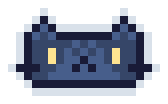

  

  <h1>Mewltiplayer</h1>

  
Play Minecraft Java Edition with friends, without port forwarding or a separate VPN.

  

    <a href="docs/commands.md">Commands</a>
    &middot;
    <a href="docs/settings.md">Settings &amp; troubleshooting</a>
  

Mewltiplayer is an independent Minecraft mod built on [Tailcat](https://github.com/tailscale/tailcat). It handles multiplayer in Minecraft, while Tailcat uses free public infrastructure to help players find and connect to each other. Game traffic travels directly between players when possible, or through a DERP relay when it isn't. Even direct connections rely on that infrastructure to get started, so availability and performance can depend on services outside our control.

Just share a world, copy a `tc...` code, and join through Minecraft's normal multiplayer menu. No separate Tailcat installation or account is needed.

## Play together

1. Install Mewltiplayer for the **same Minecraft version** on both computers.
2. Open a world and choose **Open to LAN** (1.20.1 / 1.21.1) or **World Options** (26.3).
3. Enable **Share via Tailcat** and start sharing.
4. Copy the invitation and enter it under **Direct Connection** or **Add Server** on your friend's computer.

**Using a VPN?** Tailcat may connect through a relay, have higher latency, or fail when a VPN interferes with its network traffic. Try without the VPN if connections are slow or fail; see [connection errors](docs/settings.md#connection-errors).

## Supported versions

| Minecraft | Fabric | Forge | NeoForge |
| --- | :---: | :---: | :---: |
| 1.20.1 | Yes | Yes | — |
| 1.21.1 | Yes | — | Yes |
| 26.3 | Yes | — | Yes |

Fabric requires Fabric API. Mod Menu is optional.

## Features

- Singleplayer world sharing and dedicated server support.
- Saved `tc...` servers with real Minecraft status checks.
- Direct P2P connections with encrypted DERP relay fallback.
- Host `/mew status` reports each connected player's nickname, route and measured latency.
- Fresh, per-world or global reusable invitations.
- Optional custom DERP maps and region selection.
- `/mew` and `/mewserver` commands.

**Keep invitation codes private.** A valid code allows someone to attempt to connect to the corresponding shared server.

## Documentation

- [Commands](docs/commands.md): client and dedicated server commands.
- [Settings & errors](docs/settings.md): invitations, DERP, VPN issues and error codes.
- [Tailcat](https://github.com/tailscale/tailcat): technical details of the underlying networking.

## Build from source

Use `dev.cmd <target> :core:test :platform:build` with `fabric-1.20.1`, `forge-1.20.1`, `fabric-1.21.1`, `neoforge-1.21.1`, `fabric-26.3`, or `neoforge-26.3`. Building requires appropriate Java toolchains, Gradle and Go for the bundled helper.
